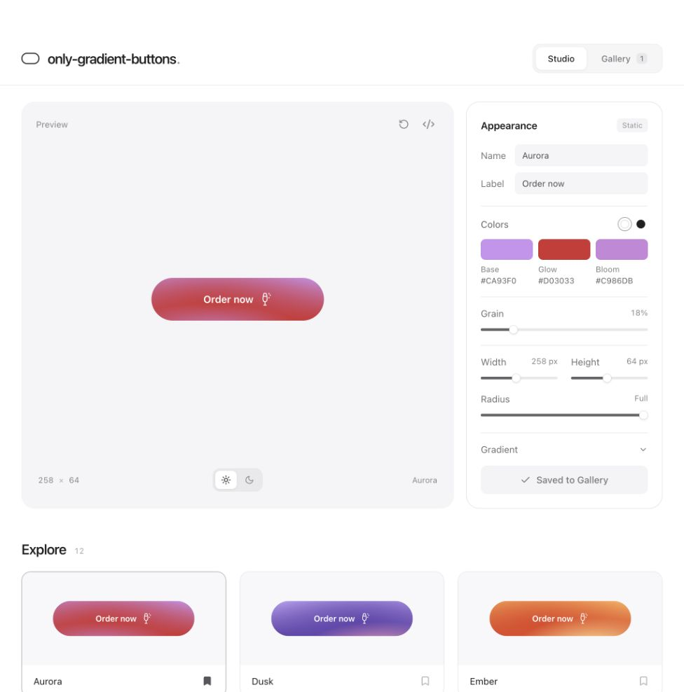

# only-gradient-buttons

A quiet studio for gradient buttons. Next.js, React, TypeScript, and plain CSS.



```sh
npm install
npm run dev
```

Open [localhost:3001](http://localhost:3001).

- The default **Aurora** reproduces the supplied three-layer gradient and SVG grain: 258 × 64 px, 18% soft-light grain, frequency 0.85, seed 7.
- Start with 12 palettes. Adjust colors, text, grain, size, corners, and gradient positions.
- **Save to Gallery** creates an independent snapshot. Select a saved button to make a variation; deletion offers Undo.
- Buttons use **Order now** with the [Phosphor Champagne icon](https://phosphoricons.com/?q=champagne).
- The code icon opens a React component and its CSS, ready to copy. The exported component requires `npm install @phosphor-icons/react`.
- The draft and Gallery are saved in this browser’s local storage. They persist across reloads on the same origin, but do not sync between browsers or devices. Clearing site data removes them.

```sh
npm run typecheck
npm run build
npm start
```

The development and production servers both use port 3001. Stop one before starting the other.

The reusable renderer is `src/components/gradient-button.tsx`; presets and export generation are in `src/lib/gradients.ts`.
